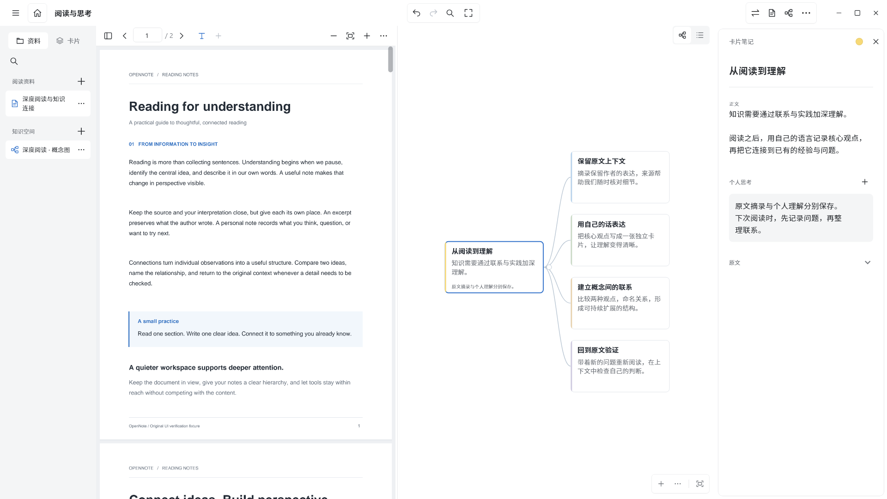

# OpenNote

OpenNote 是面向 Windows 的离线学习笔记软件，将 PDF／EPUB 阅读、摘录、卡片和脑图整理放在同一个工作区。项目代码采用 **Apache 2.0** 许可证。

OpenNote is an offline PDF/EPUB reading and knowledge workspace for Windows, licensed under Apache 2.0.



*图片使用项目自产演示资料，展示阅读、卡片编辑和脑图工作区。*

## 主要能力

- 同一学习项目管理多份 PDF 与无 DRM 的 EPUB 2／3，保存阅读位置和文档标签。
- 文字、图片与区域摘录，应用内高亮、个人思考及可独立编辑的卡片。
- 脑图、大纲、主题层级、多选、剪贴板、关联线、外框、概要与主题格式。
- 从卡片返回原文：PDF 使用页码和页面坐标，EPUB 使用章节与 CFI。
- 中英文印刷扫描页离线 OCR、全文搜索，以及包含原文、附件和笔记的完整备份恢复。

当前版本为 **0.1.0**，主要支持 **Windows 11 x64**、鼠标与键盘。功能边界见[维护基线](docs/implementation-v0.1.0.md)。

## 安装与快速开始

普通用户使用现成的 **Windows Release 包**，无需安装 Flutter、Python、C++ 工具链或自行编译。GitHub 发布后，在仓库的 **Releases** 页面选择以下附件：

| 文件 | 用途 |
| --- | --- |
| `OpenNote-<版本>-Windows-x64-Setup.exe` | 推荐：安装后使用，支持卸载 |
| `OpenNote-<版本>-Windows-x64.zip` | 便携版：完整解压后运行 `OpenNote/opennote.exe` |
| `OpenNote-<版本>-Source.zip` | 源码归档，供开发者使用 |

当前版本为 `0.1.0`。维护者负责生成、审查和上传安装包及便携包；GitHub 自动生成的源码压缩包不能代替可运行的 Windows 包。首次 GitHub Release 尚未公开时，以实际发布状态为准。

完整安装包或便携包包含应用和离线 OCR 依赖。便携包须完整解压后运行 `OpenNote/opennote.exe`，不能只复制 EXE。EPUB 阅读还需要系统 **Microsoft Edge WebView2 Runtime**；缺少时 PDF 阅读仍可使用。

1. 启动后新建学习项目，选择「添加文档」导入 PDF 或 EPUB。
2. 在阅读区选择文字或区域并摘录，使用右侧脑图整理卡片。
3. 编辑卡片正文与个人思考，通过来源回到原文。
4. 在项目首页创建完整备份，恢复前保留现有资料副本。

更多操作和快捷键见[使用说明](docs/user-guide.md)。用户资料默认保存在 `%LOCALAPPDATA%\OpenNote`，与程序安装目录分开；数据处理及反馈脱敏见[隐私说明](docs/privacy.md)。

## 从源码开发

以下步骤供参与开发或自行定制的用户使用；安装 Release 包无需执行。

工具链锁定为 Flutter 3.47.6／Dart 3.13.5，依赖版本和校验值见 `tools/toolchain-lock.json` 与 `pubspec.lock`。需要 PowerShell 7、Python 3.11 或以上，以及 Windows C++ 构建环境。OCR 原生依赖和模型按固定清单准备，不存入 Git。

在仓库根目录执行；首次运行前完成[完整环境准备](docs/build-windows.md)：

```powershell
$pythonExe = (Get-Command -Name 'python.exe' -CommandType Application | Select-Object -First 1).Source
$bootstrap = Join-Path (Get-Location).Path 'tools/bootstrap_windows.py'
& $pythonExe @('-X', 'utf8', $bootstrap)
$entry = Join-Path (Get-Location).Path 'tools/dev/flutter_dev.py'
& $pythonExe @('-X', 'utf8', $entry, 'run')
```

实际 SDK 路径保存在忽略目录 `.local/toolchain.json`，或通过 `OPENNOTE_FLUTTER_ROOT` 指定；共享锁定文件只保留可移植的默认路径、版本和哈希。开发程序使用独立资料库。

## 兼容边界

- EPUB 支持无 DRM 的 EPUB 2／3；不处理 DRM 授权，书籍脚本、外网资源及音视频不执行或加载。
- OCR 面向中英文印刷文字；复杂版面、旧字形、手写及特殊公式不能保证识别准确。
- 批注与笔记保存在应用资料库，不直接写回原 PDF／EPUB。
- 当前不包含云同步、多人协作、云端 AI、平板压感手写或完整 Xmind 文件交换。
- 各项检查的通过范围以具体源码、产物和运行环境为准。局部检查、历史结果与截图不能代替完整运行验收。

## 文档与贡献

| 文档 | 用途 |
| --- | --- |
| [使用说明](docs/user-guide.md) | 导入、阅读、摘录、编辑与备份恢复 |
| [维护基线](docs/implementation-v0.1.0.md) | 当前功能及版本边界 |
| [架构](docs/architecture.md) / [数据模型](docs/data-model.md) | 模块职责、事务、来源及数据安全合同 |
| [Windows 构建](docs/build-windows.md) | 工具链、原生 OCR 与打包 |
| [Flutter 开发](docs/flutter-development.md) / [分级验证](docs/testing.md) | 开发工具及按影响范围验证 |
| [EPUB／PDF 兼容](docs/epub-pdf-compatibility.md) | 文档格式与来源定位边界 |
| [脑图编辑](docs/xmind-basic-editing.md) | 编辑能力与待完善项 |
| [UI 设计](docs/ui-design.md) / [交互合同](docs/ui-behavior-contracts.md) | 视觉和操作约定 |
| [验证方法](docs/validation.md) | 可复现检查与适用范围 |
| [GitHub 发布](docs/github-release.md) | 开源审查、隐私检查与现成 Release 包发布 |
| [隐私说明](docs/privacy.md) | 本地资料、备份与反馈脱敏 |

参与开发请阅读[贡献指南](CONTRIBUTING.md)。普通问题使用所在仓库的 Issues，安全漏洞按[安全策略](SECURITY.md)报告。版本变化见[CHANGELOG](CHANGELOG.md)。

## 许可证

项目代码见 [Apache License 2.0](LICENSE) 与 [NOTICE](NOTICE)。第三方库、模型、字体和样本保留各自许可与来源，见[第三方声明](THIRD_PARTY_NOTICES.md)及 `packaging/source-assets.json`；本项目许可证不会替代第三方授权。
