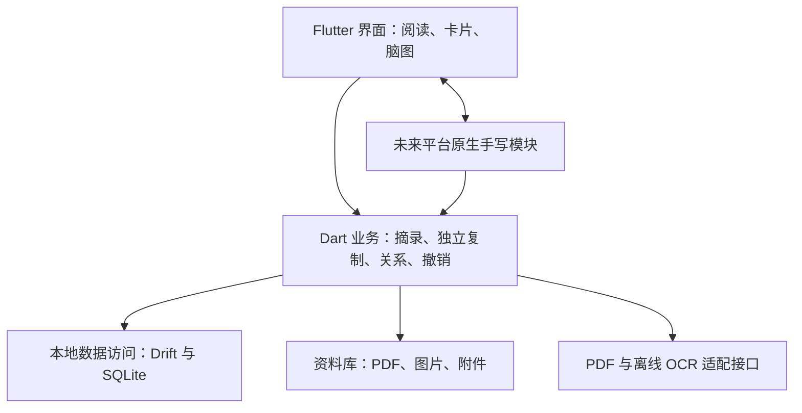

# OpenNote 架构约定

维护基线：2026-10-06，数据库 v11。本文约束当前源码；运行验证须绑定具体源码、产物和环境。

本文件与[数据模型约定](data-model.md)共同约束代码修改。功能范围见[首版范围与维护基线](implementation-v0.1.0.md)，UI 要求见[UI 设计要求](ui-design.md)，开发规则见[README](../README.md)。

## 1. 产品与技术基线

运行于 Windows 11 x64，正文与资料处理离线。核心闭环为：**导入 PDF／EPUB → 阅读或离线 OCR → 文字／图片／区域摘录 → 独立卡片 → 脑图整理 → 回到原文 → 保存与完整备份恢复**。

| 模块 | 当前实现与边界 |
| --- | --- |
| 应用与共享业务 | Flutter / Dart；业务和数据协议与界面分离 |
| PDF 引擎 | pdfrx 2.6.5 / PDFium chromium/7811；`dart_pdf_reader` 2.2.0 仅解析 MediaBox、CropBox、Rotate 和 UserUnit，不引入第二个渲染器 |
| EPUB 引擎 | flutter_inappwebview 6.1.5 / 系统 WebView2，epub.js 0.3.93 / JSZip 3.10.1 在 assets 本地打包；只读 ZIP／OPF 解析在 isolate 内完成 |
| 本地数据 | Drift 2.35.1 / sqlite3 3.7.0；SQLite 在后台 isolate，业务修改通过仓储事务提交 |
| 离线 OCR | PP-OCRv6_small / ONNX Runtime CPU 1.21.0；C++ 窄 C ABI + Dart FFI，OpenCV 4.11.0 负责图像预处理 |
| 脑图与卡片 | Flutter 画布与文本、图片组件；单父树、带说明／箭头／样式的关联和独立卡片，不把控件对象当作持久化格式 |

依赖锁定见 `../pubspec.lock`，工具链见 `../tools/toolchain-lock.json`，OCR 包见 `../assets/ocr/manifest.json`。模型、字典、配置和哈希固定，处理版本为 `opennote-ppocrv6-small-cpu-v2`。产品从自身目录显式加载 `opennote_onnxruntime.dll`，避免同进程旧版 ORT 库冲突。

## 2. 模块职责

- **界面层**负责显示、输入和临时状态，不另建持久化规则或通过控件状态单独维护卡片正文。
- **业务层**负责批注、摘录、卡片、脑图关系、数据一致性和应用级撤销，不依赖控件、PDF 包内部对象或平台绘图对象。
- **数据层**负责查询、事务、迁移与一致性快照；资料库负责不可变资源的校验和引用，使用 ID 与相对路径定位。
- **引擎适配**负责 PDF 渲染、文本提取、OCR 推理和坐标转换；C ABI 明确内存归属与异常边界。

以上职责不要求各自成为独立进程或包。OCR、批量索引和数据库工作避开界面执行路径，不为未来需求预建空实现或通用插件框架。

## 3. PDF、OCR 与原文生命周期

- `OpenNoteShell` 统一持有资料库、OCR 队列和应用退出处理。首页按摘要分页查询；用户明确选择项目后，每次只挂载一个接收 `projectId` 的工作台。普通启动不会自动选择首个项目。
- 返回首页先关闭命令入口、等候已接受命令、提交编辑与导航状态、等待 PDF 实际关闭，然后卸载工作台。失败保留工作台和可重试错误；首页继续既有 OCR。返回与退出请求去重，退出等待正在进行的返回／全局操作后再排空 OCR、关闭资料库。
- 完整恢复只能从首页发起。恢复成功更换资料库会话、封面缓存及首页状态；旧工作台与封面请求不得更新新会话。

- 导入原始 PDF 保持字节不变，固定复制至托管资料库；应用批注、OCR、卡片与脑图数据独立保存。
- 摘录绑定文档版本、页码、PDF 页面坐标与原文快照。缩放、旋转、裁切、DPI 或窗口变化不能改变锚点含义；更换 PDF 字节或结构创建新版本，不能静默沿用旧锚点。
- 原生页使用已有文本层，扫描页进入离线 OCR；混合文档按页判断。后台渲染、推理、保存文字框及置信度；处理图像上的文字框映射回原 PDF 坐标。
- OCR 可取消、续跑和复用，模型随包提供，识别时不上传文件、不依赖云服务或首次联网。重识别不改写已有卡片、个人思考或原文快照。
- 原生字符框为精确字符几何；OCR 的 CTC 字框为近似定位，不能把普通 OCR 当作公式、表格或版面结构解析。
- 阅读器按当前页及相邻页准备文字层，全书索引交给持久后台队列。自动索引只补缺失任务；取消或失败页由显式识别、重试重新排入。
- 每个阅读视图独立拥有一次 PDF 打开与关闭。卸载、换文档须释放迟到返回的原生文档，关闭后不累积 Future 历史。
- 正常退出排空已接受的业务命令、保存草稿和当前识别页，剩余任务供下次续跑；恢复前停止旧视图、后台任务并等待实际关闭。失败如实传播，不能用固定延时、删除重试或忽略异常代替关闭完成。

## 4. 卡片、脑图与编辑合同

EPUB 资源通过随机会话令牌的回环 HTTP 服务加载，路径必须命中解析后的资源清单。禁用书籍脚本、媒体与自动外网资源；应用桥接核对资料库会话、文档版本和阅读器代次。正文以 XHTML/XML DOM 渲染，避免 HTML 自动插入表格节点改变 CFI。书籍中的 base 被移除，阅读引擎只生成同源的章节基准地址。

关闭阅读器先停止接收新意图，卸载后等待 WebView 原生句柄及环境实际释放，再关闭本地服务；迟到创建的视图也纳入同一关闭 Future。控件卸载后不等待无法保证返回的 JS 回调，原生视图释放会销毁 epub.js。Windows 子插件的环境通道和去重关闭修正保存在本地许可子包，并记录上游及改动哈希。WebView2 不随包附带，缺失时 EPUB 明确提示，PDF 保持可用。

PDF 来源仍绑定页码及页面几何。EPUB 来源绑定章节路径、CFI 点／范围、选文和前后文；区域截图保存独立不可变 PNG，图片裁剪另记原图内相对矩形。重排页码和屏幕坐标只参与当前交互。回源先校验章节、选文及上下文，失败明确反馈。正文按章节生成 UTF-16 文本节点到 CFI 的映射，逐章提交并支持暂停、恢复；按需图片 OCR 与 PDF 共用串行原生引擎，结果不替代正文或旧卡片。

- 打开的文档标签及顺序、当前文档／脑图持久保存在项目导航记录，不改变文档归属或业务撤销；图文联动模式、选择和主选仍是临时状态。关闭文档不删除原文、阅读位置或摘录。
- 回源、选择和编辑是不同意图。定位按联动模式执行；导航动画取消不能阻塞业务队列，实际定位失败仍须反馈。
- 面板打开状态、正在编辑的卡片与脑图选集分别维护。双击正文、F2 或右键编辑打开后，同项目保持面板；普通单击其他卡片先提交旧卡标题、正文和个人思考，再更新面板，不请求正文焦点。画布空白清除真实选集，保留编辑内容；PDF 操作和画布/大纲切换保持面板。同项目换图或当前目标删除后保留面板并显示“请选择卡片”，不保留虚假选择。
- 叉号先保存再关闭，失败保留面板及草稿并允许重试；关闭后的普通单击不重开。返回首页、更换项目或资料库会话后重置面板。宽屏停靠/窄屏浮动共用同卡编辑器身份，窗口和文字缩放不替换草稿会话。
- 编辑意图接受时固定资料库会话、脑图、节点与卡片身份；按队列先提交原草稿，再读取并校验目标。后来的选择不能改写已接受的目标，异步请求须检查身份及上下文。编辑器布局完成后，通过当前编辑器委托同步交接正文焦点，保留挂载状态、卡片身份、委托归属和当前上下文检查；后续选择意图使旧焦点请求失效，不再追加迟到的焦点回调。
- 快速切卡、关闭与资料库恢复使旧焦点和异步界面请求失效；保存反馈绑定当前面板卡片，旧卡结果不得覆盖新卡状态。沿用串行保存/命令队列及资料库会话检查。
- 画布普通完整单击即时按联动模式定位；双击同一卡片进入共用编辑器并聚焦正文，Ctrl 点击、拖动或取消手势不触发双击编辑。`F2` 在队列执行时取最新主选，并保留多选集合。
- 画布及大纲标题双击或 Space 打开局部标题输入；画布正文双击和两种视图的 F2 保留共用正文编辑器。标题草稿携带明确目标与代次，与工作台命令队列一起提交，保存失败不丢弃。视图切换先保存标题，正文编辑器保持原子树和草稿；失败不切换。原文快照不可编辑；基础编辑进度见 [Xmind 基础编辑对照](xmind-basic-editing.md)。
- 项目、文档与脑图重命名修改同一实体，沿用事务与撤销，不删除重建或改写引用。PDF 内部链接使用公开定位接口，无效或未支持的目标如实反馈。
- 创建主题显式传入父节点及可选位置：子主题归入目标，同级主题沿用其父级，顶层没有父节点；新主题不复制目标的来源、个人思考或关联。
- 卡片用户内容包括标题、正文及有序 `PersonalThought` 条目。编辑器空输入草稿不持久化；仓储在一次卡片更新中保存思考 JSON 与兼容预览，自动保存、关闭提交、撤销、独立复制、搜索和备份使用同一合同。
- 面板顶部当前色圆点打开七色色板；异步回调捕获卡片及资料库会话，先提交文字草稿，再改色，不重建输入框或触发 PDF 跳转。右键和多选改色共用仓储更新路径，按 `annotations.card_id` 同步全部关联标注，与卡片共用事务/撤销；失败整笔回滚。取消色板不提交，关闭色板交还原输入焦点，不在迟到保存后抢焦点。
- 改色不推断相同锚点的关联、不补建标注，也不改独立副本或无关联标注；PDF 保持既有透明度和几何。历史色差不批量修正，重选当前色可同步旧标注，已一致时不生成历史。卡片颜色与主题填充分开。折叠命令读取执行时的状态。
- 大纲由唯一父关系派生，与画布共享卡片身份、选择和折叠状态；显示变化不产生业务撤销，定位须使目标可见，普通刷新不夺回用户滚动位置。
- 大纲逐行键盘选择与画布框选通过精确选集回调交接身份，不触发 PDF 激活。框选仅在工具开启或 Shift 空白拖动时竞争手势，默认空白平移保持原行为；逐帧只改变局部预览，抬起时串行提交一次选择。已接受的 Pan 收到指针取消也可能发结束回调，先撤掉预览，避免误提交。新主题选择使用已提交身份交接，不依赖可能尚在刷新的界面快照。
- 选择与后续命令按输入顺序处理，批量命令捕获全部已接受目标；不得读取草稿保存期间未更新的旧选择或在执行中替换目标。
- 组移动处理所选分支完整并集，父子重叠只平移一次，包含折叠后代；一次位置事务不改变关系。成员、父关系、起点或目标失效时取消整个预览。
- 临时位置只服务未提交预览；成功、失败回滚和撤销后的权威快照必须接管显示，旧预览不能覆盖新模型。
- 命令等待的刷新覆盖已有待处理通知；并发显式读取若使旧读取失效，等待最新实际读取完成。后台 OCR 等通知不抢占正在读取的前台结果，读完后合并补齐变化；切图、切库和卸载仍按原代次隔离。自动排布坐标与鼠标落点不同也交还绘制位置，立即撤销不要求先显示保存确认帧。
- 批量操作先校验全部目标，再在一个事务提交并产生一次撤销。用户删除分支消除重复祖先覆盖，同时回收卡片和节点；关联 PDF 批注按有效卡片、项目和显示位置过滤，原记录保留供恢复。仅移除位置的仓储接口用于明确的位置操作，不作为界面删除入口。
- 快速插入父主题、前后同级主题及为整条分支让位共用一次事务；仅删当前节点时提升直接子节点并保留后代。复制剪贴板捕获不可变内容；剪切在粘贴提交后移动，失效结构整批拒绝。内部剪贴板按资料库会话隔离。
- 卡片正文、原文锚点、脑图位置与关系分别建模。复制主题或完整分支创建新卡片身份与独立可编辑内容，副本修改不影响原卡。
- 完整分支复制包含后代和分支内部关联，不复制跨分支关联；跨项目复制映射文档、版本及锚点。移动与复制分别处理。
- 脑图为单父无环树，同图关联的端点对唯一，箭头只表示关系方向；每张卡片最多一个有效脑图节点。布局与视觉分组不能反向定义知识关系。
- 自由、左右逻辑图、双侧及上下组织结构共用纯领域布局计算；可空节点结构继承最近上层，局部双侧仅在其直接分支处分流。混合结构按子树边界两趟迭代排布，自由子树保留相对坐标。仓储在原结构命令事务内保存模式、顺序、方向和位置，复制／跨图移动固定根的有效结构。画布连接端点与键盘父子方向随分支结构切换，大纲及剪贴板使用相同顺序。拖放中心为子主题，结构布局的前后区域为同级插入；提示及插入线只更新画布，松手后统一验证捕获身份并以一次事务保存。普通菜单仍单目标，格式和分支结构保留精确多选。布局计算迭代遍历完整树以检查循环，折叠后代保持原位置。树形、大括号、横纵时间线及左右鱼骨共用相同分支覆盖合同；主轴和括号通过纯领域几何计算并批量绘制，概要有效方向按范围外侧计算并在快照刷新时缓存。结构选择器使用同一几何生成示意图，应用前通过工作台命令队列提交草稿。数据库 v9 扩大结构枚举约束，旧库先保存含 WAL 的一致性快照，事务重建表并检查引用；旧备份暂存升级成功后才切换。
- 关联曲线的绘制、命中和控制柄共用纯领域几何。说明、手动端点和控制点独立保存；拖动只更新局部预览，松手发一次命令，失败撤回。规范端点换序时同步交换两端样式；内部关系随复制保留。说明草稿在工作台命令、视图切换和离开前提交，异步结果绑定原脑图、关联和端点身份。
- 外框为独立 `MapBoundary`，同级范围与可见后代由共享领域计算确定。边框命中不吞掉框内主题；范围拖动只更新局部预览，指针取消不写入，松手提交一次。层级变化只维护受影响脑图的外框，并与原命令共用事务和撤销；普通位置拖动不触发全库查询。说明草稿携带脑图、外框、范围和编辑代次，视图切换及离开前提交，失败留在原位。
- 概要使用独立 `MapSummary` 与正常卡片／节点，主题文字和子主题沿用现有编辑及草稿生命周期。普通布局先排主树，再按依赖放置概要子树，跟随左右／上下方向并避开其他主题；折叠范围保留坐标。括号、命中和范围手柄共用几何；鼠标抬起只提交一次，取消、保存失败及陈旧快照不留下预览。完整范围复制捕获概要及子主题，移图／重挂在原事务内维护引用；主题样式变化同步失效节点绘制缓存。
- 普通主题、概要主题及本图默认格式共用 `TopicStyle` 与领域解析器，概要主题仅使用概要元数据作为持久格式来源。画布在快照变化时批量解析并缓存有效格式，拖动帧不逐节点查询仓储；按相同分支样式批量绘制曲线／直线／折线及箭头，虚线有真实间隙。形状裁剪覆盖卡片颜色条，选框和命中区域仍按原节点尺寸。大纲标题使用相同字体／字号／颜色，行高随字号和文字缩放增加。格式弹窗先提交现有草稿，再捕获精确选集及卡片身份；保存为一次局部命令，不切换全局忙碌按钮。
- 文本编辑撤销与应用级撤销分别处理；应用撤销只保留本次会话。回收站持久保存，删除 PDF 后已有卡片仍可回源，永久清理检查全部存活引用。

## 5. 本地存储、备份与恢复

- SQLite 保存结构化数据，PDF 与图片放资料库；正式资料存于应用数据目录，不放源码目录，不用网盘直接同步运行中的数据库。
- 文件写入与 SQL 提交不是同一事务；资源先暂存、校验再提交引用，失败不能留下指向缺失文件的记录。
- 完整备份包含一致数据库快照、原文、附件、OCR、批注、笔记、回收站、格式版本与哈希清单，不依赖原机器路径。
- 使用 SQLite 一致性备份机制，不直接复制运行中的数据库；同时协调资源新增和删除，保证快照与引用相符。
- 恢复先隔离校验格式、哈希、引用与数据库完整性，再保存原库安全备份并切换；失败不能损坏原库，旧后台结果不能写入新库。
- 数据迁移保留一致语义与版本规则；旧客户端不能修改不理解的新格式。详细规则见[数据模型约定](data-model.md)。

## 6. 长期平台与手写边界

长期支持方向仍为 iPad 或 Android 平板，压感、低延迟与防误触是核心要求；首版不包含手写，也不预设尚未确认的平台或设备验收结果。

- 保留平台原生手写接入边界，与共享业务和 PDF 页面坐标协议兼容；桌面界面缩放不能替代平板适配。
- 实时输入、预测与误触取消在原生模块内处理，完成后批量提交有效笔迹；临时预测点与被取消输入不持久化。
- 笔迹使用独立、有版本的通用格式，平台对象不能成为唯一数据形式；合成、笔刷与设备体验在对应版本实际验证。

验证与交付记录见[首版验证摘要](validation.md)。维护修改须针对实际数据合同和受影响行为验证。
