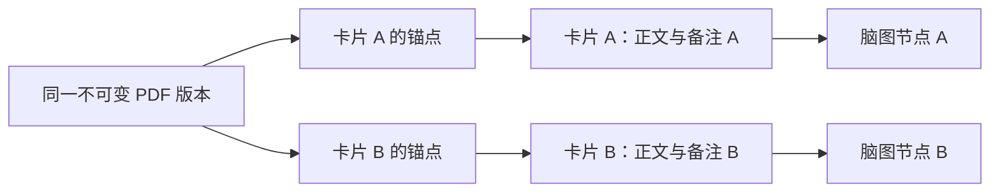

# OpenNote 数据模型约定

适用版本：当前 EPUB／PDF 源码，数据库 v11。更新日期：2026-10-08。本文记录当前生效的数据实体、不变量与持久化契约。

本文件与[架构约定](architecture.md)共同约束代码修改；开发规则见[项目 README](../README.md)。实体与字段以 `lib/domain/models.dart`、数据库表以 `lib/data/database.dart` 为准，后续修改必须保持身份、所有权和数据语义。

## 1. 核心原则

1. 文档身份、文件版本、应用批注、原文锚点、卡片内容、脑图显示和 OCR 结果分别建模。
2. 文件路径是定位信息，不是文档或卡片身份；持久 ID 不依赖本机绝对路径或 UI 控件对象。
3. 原始 PDF／EPUB 与不可变资源可以共用；每份独立卡片拥有自己的可编辑内容。
4. 保存文档版本与分格式来源：PDF 页面坐标，EPUB 章节和 CFI；屏幕缩放、DPI 和重排变化不能破坏原文定位。
5. 识别结果、导出格式和数据库结构都有版本，重识别或升级不能静默覆盖用户内容。
6. 首版不包含同步、复习、手写和云端 AI，不为范围外功能预建数据系统。

## 2. 当前实体与持久化

新建项目的初始脑图及单独新建脑图显式保存 `layout_kind=right`，新建 `MindMap` 模型同样默认向右自动布局。历史数据库默认值、旧版本升级与旧备份读取仍保留 `free` 的原语义，不进行批量重排，数据库结构版本不变。自由父级接受拖入子主题时，在同一 Writer 中将目标主题的 `branch_layout` 改为 `right`，连同顺序、层级和坐标一次保存及撤销。

| 实体 | 身份与主要信息 | 职责与所有权 |
| --- | --- | --- |
| `StudyProject` 学习项目（`projects`） | `id`、标题、创建时间、回收时间 | 一个项目拥有多份逻辑文档、多张脑图和独立卡片 |
| `ProjectFolder` 一级分类（`project_folders`、`project_memberships`） | 文件夹 ID、标题、创建时间；项目 ID 与可空分类 ID | 删除分类只取消归属；旧项目归入未分类；支持业务撤销 |
| `ProjectResumeState` 项目导航（`project_sessions`） | 最近访问、最近成功阅读文档、当前文档／脑图、标签顺序 | 不进入业务撤销，也不清除重做；删除的对象在恢复时过滤 |
| `ProjectSummary` 分页摘要 | 项目、分类、聚合数量、封面资源路径／哈希 | 首页通过 SQL 分页聚合查询；不加载项目卡片正文与完整脑图 |
| `ResourceRecord` 资源（`resources`） | `id`、SHA-256、类型、大小、资料库相对路径 | 保存不可变 PDF、图片或附件；多个记录可以引用同一资源 |
| `ManagedDocument` 逻辑文档（`documents`） | `id`、`projectId`、标题、`activeRevisionId`、回收时间 | 应用内文档身份；不以路径或文件哈希直接替代 |
| `DocumentRevision` 文档版本（`revisions`） | `id`、`documentId`、`resourceId`、内容哈希、页数、页面几何 | 绑定明确 PDF 字节与页面结构；已有版本不原地改写 |
| `PageTextLayer` 页面文字层（`text_layers`） | `id`、`revisionId`、页码、来源、文本、文字片段、处理版本与参数、当前版本标记 | 保存原生文本提取或 OCR 的可追溯结果；新一轮处理生成新版本 |
| `AppAnnotation` 应用批注（`annotations`） | `id`、`revisionId`、页码、几何区域、类型、内容、颜色、可选 `cardId` | 批注可以独立保存，不以回源锚点或 PDF 内部对象代替 |
| `NoteCard` 卡片（`cards`） | `id`、`projectId`、标题、独立摘录快照、正文、`thoughts_json` 个人思考、兼容预览 `note`、颜色、图片资源、回收时间 | 复制产生新 ID 与独立可编辑内容，不通过引用旧卡片实现副本 |
| `PersonalThought` 个人思考条目 | 非空 `id`、字符串 `text`；顺序由卡片的 JSON 列表保存 | 是卡片内的值对象，不是独立数据库表；同一卡片内 ID 唯一，不共享可变集合 |
| `SourceAnchor` 原文锚点（`anchors`） | `id`、`cardId`、`revisionId`、页码、几何区域、文字层与选文范围、上下文 | 一个卡片可无来源或有多个来源；复制卡片时复制锚点记录 |
| `MindMap` 脑图（`maps`） | `id`、`projectId`、标题、`layout_kind`、`default_style_json`、回收时间 | 脑图容器及默认主题／分支格式；自由、左右逻辑图、双侧、上下组织结构；不拥有唯一一份卡片正文 |
| `MapNode` 脑图节点（`nodes`） | `id`、`mapId`、`cardId`、`parentNodeId`、画布位置、尺寸、折叠状态、`sort_index`、`branch_side`、可空 `topic_style_json`、可空 `branch_layout` | 放置卡片并记录单父层级；保存同级顺序及局部双侧方向；空结构继承上层，空格式继承默认，节点 ID 与卡片 ID 不混用 |
| `MapEdge` 脑图关系（`edges`） | `id`、`mapId`、`fromNodeId`、`toNodeId`、`label`、`style_json` | 同图唯一端点对，方向由两端箭头表达；说明、曲线、锚点与文字样式独立持久化 |
| `MapBoundary` 外框（`boundaries`） | `id`、`map_id`、`parent_node_id`、`node_ids`、`label`、`style_json` | 同分支连续范围及可见后代；独立说明、形状、填充和线条／文字样式；不改变卡片或父子关系 |
| `MapSummary` 概要（`summaries`） | `id`、`map_id`、`parent_node_id`、`summary_node_id`、`node_ids`、`style_json` | 概要范围与括号／主题样式；文字通过独立卡片保存，概要节点可有普通子主题；布局不把概要当作普通并列分支 |
| `ReadingPosition` 阅读位置（`reading_positions`） | `revisionId`、页码、偏移、`settings_json` | 按文档版本保存阅读位置与阅读设置；PDF 目录偏好保存在 `settings_json.pdf` |
| `OcrTask` 识别任务（`ocr_tasks`） | `id`、`revisionId`、页码、模型版本、状态、错误、会话标识 | 保存排队、运行、完成、取消和失败状态，支持重启续跑 |
| `TrashEntry` 回收记录（`trash`） | `id`、类别、实体 ID、`projectId`、标题、删除时间；表内保存恢复快照 | 回收站跨重启保存，并随完整资料库备份导出 |

页面几何、文字片段、选区和处理参数使用结构化 JSON 保存；实体引用和业务事务由仓储统一维护。卡片颜色、节点尺寸和坐标是用户数据，不定义新的 UI 视觉样式。

PDF 目录偏好由 `PdfReadingSettings` 表示，包含 `sidebarVisible` 与 `sidebarWidth`，默认关闭、宽 220，持久化宽度范围 120–440。偏好绑定 PDF 修订 ID，不按文件路径或资源哈希共享；同内容的独立文档保持各自设置。保存目录偏好与阅读位置串行执行，保留页码、偏移和其他设置字段，不进入业务撤销，也不清除重做。旧记录缺少 PDF 设置时使用默认值，无需新增数据库迁移；备份与恢复随阅读记录保留设置，旧资料库会话的写入被拒绝。窗口临时变窄仅约束显示宽度，不回写偏好。

数据库结构版本现为 v11。旧库升级前通过 SQLite `VACUUM INTO` 保存包含已提交 WAL 内容的一致性快照，再事务执行缺失迁移。v10 的个人思考迁移保持原约定。v11 为文档版本增加 `format` 和 `metadata_json`，旧版本默认 PDF。锚点、批注和阅读位置增加 `locator_json`，EPUB 的 `page_index=NULL`，PDF 的 ID、页码、几何、颜色与内容原样保留；阅读位置另记 `settings_json`。`epub_sections` 保存章节元数据及可重建文本／CFI 索引，`epub_image_ocr` 保存原图／截图资源、来源、识别结果及引擎身份。迁移在事务中完成，未知来源触发器或索引会拒绝自动重建，失败完整回滚。

EPUB 的原件按 SHA-256 托管且字节不变。解析内容、封面与渲染缓存可重建；独立截图、应用批注和图片 OCR 属于用户数据，随完整备份保存。复制分支时同时复制所属 EPUB 文档版本、章节索引及 OCR 来源，再映射锚点版本 ID。备份容器仍为格式 1，通过数据库版本区分内容；旧备份在暂存区校验并升级后才激活。

v2–v8 迁移补齐分类／导航、脑图结构、关联字段、外框、概要、主题格式及分支结构字段。v9 扩大结构 CHECK 枚举，在事务外临时关闭外键，再事务重建 maps／nodes；显式复制全部既有列与 ID，重建标准索引，提交前检查全部引用。失败回滚原表；非标准索引或触发器拒绝升级，不删除定制对象；禁止破坏性重建覆盖。旧脑图默认自由布局，原坐标不变；旧关联默认无说明、直线虚线、无箭头；旧主题没有分支结构覆盖。

完整备份接受 v1–v11，旧备份先按对应版本验证并在暂存区升级，再切换活动库。v3 校验布局，v4 校验关联说明与完整样式，v5 校验外框范围和样式，v6 校验概要主题唯一性、同图／同级范围及样式，v7 严格校验主题／分支格式并拒绝概要主题的重复格式，v8 校验可空分支结构枚举；v9 接受新增八种结构名称，v8 及更早备份继续使用对应旧枚举。v10 要求思考列表结构及每条字符串字段正确、条目 ID 非空且不重复，列表合成文本必须与 `note` 一致。v11 另校验 EPUB 章节与图片 OCR 表、来源定位与章节引用、阅读设置、章节路径及文字索引，并检查图片 OCR 的结果结构与引擎身份；PDF 来源仍须使用整数页码且不带 EPUB 定位。损坏内容拒绝激活。永久删除项目清理外框、概要、分类归属和阅读记录；删除文档清理标签 JSON 与导航外键。

`thoughts_json` 保存分条内容，`note` 为以两个换行连接各条文本的兼容预览，供旧调用及统一检索等路径使用。更新思考时两者一次提交；旧 `note` 更新入口在内容变化时转成单条思考，不允许同一次调用同时提供 `note` 和思考列表。未填写的新输入草稿不进入持久列表；旧备注迁移保留原内容。标题、正文、思考快照共用卡片保存、撤销、复制和备份合同。

`TopicStyle` 包含主题表面／标题与分支线条。普通节点格式保存于 `nodes.topic_style_json`；空值继承本图默认表面与分支，概要后代的空格式优先继承最近概要的分支线。概要主题的格式仅由 `summaries.style_json` 保存，不能同时设置节点格式；移除括号时将它转存至节点，保持可见格式。修改精确选集、可选后代及本图默认格式共用一次事务与撤销。卡片颜色与主题填充分开，原文和用户正文不因格式命令改变。复制或跨图移动捕获普通主题的有效格式，概要主题继续由概要元数据保存；副本不受源图后续默认格式变化影响。

概要范围以连续普通同级主题的首尾锚点计算，排除概要主题自身；复制完整范围时自动包含对应概要主题及其子主题，部分范围不复制括号。复制或回收父卡片后产生的自由主题保留明确范围 ID，不把其间无关自由主题纳入概要。单独移走概要主题会将其转为普通主题；移除括号保留内容，删除概要主题则移除其分支显示位置。结构维护、原命令和布局保存共用 Writer 事务及一次撤销。

外框范围以持久首尾主题界定，首尾之间新插入的同级主题自动纳入；绘制包含可见后代，折叠时跟随实际可见范围。不同分支的选集分别创建外框，多个自由主题不能共用一框。局部重挂将移出的主题排除原范围，整组移图保留外框身份；整组变成多个自由主题时分别保留其外框与说明。完整范围随分支和不可变剪贴板复制，部分复制不制造空框。删除外框保留全部主题；移除分支、复制、范围维护及撤销使用同一次 Writer 事务。永久清理移除或修剪对应范围，备份不允许悬空引用。无资源的备份恢复后仍创建资源目录。

关联端点仍按 ID 排序保证唯一，换序时交换箭头、手动锚点、曲线控制点及跟随颜色的端点，保持可见方向和曲线形状。控制点相对各自主题中心保存，手动锚点按主题矩形边界的 0–1 坐标保存；未固定的端点随主题位置自动投影。说明相对路径中点保存偏移。复制分支／剪贴板保留样式并重新映射身份；新自由主题与关联在一个事务中创建。拖动中只预览，松手提交一次，取消、身份失效或失败撤回预览。

结构布局按保存的非负整数 `sort_index` 浏览和复制，局部双侧主题的直接分支以 `branch_side=-1/1` 固定方向，后代沿所属方向继承。`branch_layout=NULL` 继承最近上层或全图结构；显式值控制该主题的子树，内层覆盖继续保留。切换全图结构不清除分支覆盖；自由父级的子主题清除顺序索引，结构父级的子主题保留逻辑顺序。自由分支保留手工相对坐标，自动分支按完整子树边界排布。复制／跨图移动的根固定当时有效结构，内层显式覆盖保留。新增、插入、层级／顺序调整、复制、移除及折叠展开与重新布局共用一次业务事务和一次撤销。拖放锚点记录身份、父级及结构，旧目标变更或保存失败不提交部分顺序。隐藏后代在折叠时保留坐标，展开后重新排布。布局不改写卡片正文、个人思考或原文锚点。

封面位于活动库 `cache/project-covers/`，以 PDF 内容哈希、渲染宽度与缓存版本命名。它属于可再生缓存，不进入 `resources` 或备份。首页最多两路渲染；离屏排队请求取消，切库后旧请求结果丢弃。

### 2.1 原文与用户内容

- 摘录原文快照与用户编辑的正文／个人思考分开，能区分“来源当时是什么”和“用户后来写了什么”。
- 卡片复制应复制自己的正文、个人思考条目及顺序、颜色和摘录快照，不能留下共享的可变对象。
- 重新 OCR 不自动刷新旧卡片快照。用户主动修正、替换来源或重新摘录时，通过明确业务操作提交。
- 图片和原 PDF 可以按内容去重；资源字节保持不可变，变更内容须产生新资源或独立编辑数据，不覆盖其他卡片引用的资源。

### 2.2 页面文字层

- 标明来源为 PDF 原生文本或 OCR，并绑定明确文档版本和页面。
- OCR 结果至少可追溯识别引擎／模型版本、处理参数、文本、坐标及置信度；保存能够重建选择与搜索所需的信息。
- 文本框应明确属于行、词、精确字符或近似字符，不能将行级框伪装成精确字符框。首版原生 PDF 使用精确字符框；OCR 保留检测行框，并按 CTC 解码位置估算字符框，标记 `approximateCharacter`。选文精度取决于实际输出与验证。
- 如果识别前旋转、裁切或纠偏，保存必要变换并将最终框还原到原页坐标；不能只保留处理图像的像素位置。
- 新识别结果可以成为当前搜索文字层，但旧卡片引用的来源、几何位置和快照仍可解释。

### 2.3 应用批注与来源锚点

- 批注表达用户在原文上的标记或备注；来源锚点表达卡片引用哪一段原文。两者职责不同，未生成卡片的批注也必须能够独立保存。
- 摘录操作可以同时产生批注和卡片，并记录可选关联；不能通过该关联共享独立卡片的正文或个人思考。
- 当前批注类型为 `highlight`、`region` 和 `note`；标准 PDF 批注写回与手写数据不属于首版。
- 删除或编辑批注与修改卡片是不同操作，不级联删除卡片或改变其回源依据。
- 批注使用第 4 节的页面坐标规范，并作为持久用户数据进入完整备份。
- 卡片显式改色时，只按 `annotations.card_id` 同步归属该卡的全部标注，可跨页、跨类型；卡片与标注共用一次事务和一次撤销，失败全部回滚，撤销/重做同时恢复两者颜色。标注自身编辑不反向修改卡片颜色。
- 不按相同原文位置或锚点推断归属，不补建标注，不修改独立副本或无关联标注。标注身份、页码、几何和绘制透明度保持原值；主题填充与卡片颜色仍分别设置。
- 历史色差不在迁移或读取时批量修正；用户重选当前卡色也执行关联同步。卡片与关联标注全部已一致时不生成历史记录，不清空重做。
- 卡片关联批注仅在卡片、项目、脑图及显示节点均有效时显示；回收卡片时保留原批注行和来源，恢复后重新显示。无卡片关联的手动批注不受该过滤影响。历史孤立卡片不自动回收，但其关联标注停止显示。

## 3. 独立复制语义

执行“复制卡片”时必须满足：

1. 新建 `cardId`；复制所属可编辑数据，并为需要独立修改的关联记录生成新身份。
2. 为副本创建独立 `SourceAnchor` 记录；文档版本、原文几何信息和不可变资源可保持相同。
3. 如果复制进入另一脑图，创建新的 `MapNode`，不能复用原节点身份或把原卡片引用当成独立副本。
4. 修改、移动或删除副本，不改变原卡片的正文、个人思考、锚点、节点状态及原卡关联标注；原文资源可复用，标注归属仍以卡片 ID 为准。
5. 复制涉及的数据库变更在一个完整业务操作和事务中提交，失败时不能留下半份副本。

首版复制完整分支及其内部关联，为卡片、锚点、节点和关系创建新 ID；不复制分支外关联。跨项目复制先建立独立逻辑文档和版本映射，不跨项目引用可编辑记录。

“移动节点”保留原节点及卡片身份；“复制卡片”产生新身份，不能把独立复制改成联动编辑。

主题快捷插入、上层主题插入、同级排序及仅移除当前节点都在同一 Writer 事务中调整相关节点。底层仅移除位置接口提升直接子节点并保留卡片；界面 Ctrl+Delete 使用卡片回收命令，提升子主题并保留顺序。普通界面分支删除包含全部后代卡片。位置调整保留分支内部的相对坐标。

应用剪贴板是资料库会话内的不可变内容快照，不增加数据库表。复制捕获当时的正文、分条个人思考、来源及内部关联；粘贴独立副本通过上面的身份映射合同提交。准备剪切不删除原分支；粘贴时检查原分支身份和层级仍有效，再原子移动，失败保留原数据。外部缩进文本最多一次创建 2000 个主题，非法缩进或目标失效整批回滚。粘贴完成为一次业务撤销；单纯选择、键盘导航和框选不进入业务历史。

## 4. 原文坐标规范

持久化锚点使用应用定义的 PDF 页面坐标规范：

- 标准页面用户空间，原点／坐标轴按 PDF 页空间解释，不采用屏幕左上角像素坐标。
- 保存页面可见区域 `CropBox` 的范围与偏移、必要的 `MediaBox` 信息、页面旋转和单位比例 `UserUnit`；不得假定所有页面原点为零。
- 缩放、DPI、旋转与窗口位置只属于显示变换；锚点几何在页面未发生变化时保持不变。
- 多行文字用多个矩形／四边形表达；倾斜文字不能只靠一个屏幕包围框描述。
- 跨页摘录按页拆成锚点片段，每个片段记录自己的页码和几何信息。
- 字符索引、摘录上下文和文本快照可以辅助定位，但不能单独作为跨引擎或重识别后可靠的身份。

PDF 包返回的坐标必须经过明确适配；若其坐标已做旋转、裁切偏移或单位归一化，不可再次重复转换。坐标验证须覆盖非零页边界、旋转页、缩放和 OCR 页面。

pdfrx 提供 PDF 页坐标与文本选择接口，这支持上述方案；应用仍需统一引擎与自身的数据约定。[PDF 坐标接口](https://pub.dev/documentation/pdfrx_engine/latest/pdfrx_engine/PdfRect-class.html)、[文本选择说明](https://github.com/espresso3389/pdfrx/blob/master/doc/Text-Selection.md)

## 5. 身份、引用与删除

- 应用实体使用稳定的持久 ID；跨端导出／恢复不得因路径改变而替换身份。
- 同一文件可以去重复用资源，但不能因此自动合并两份独立卡片或不同学习上下文。
- 外键或等效约束保证节点、关系和锚点引用存在的实体。
- 用户界面的脑图删除明确将对应卡片移入回收站；Delete 包含全部分支后代，Ctrl+Delete 只回收当前卡片并提升子主题。不永久清除正文、来源或关联批注。仓储的仅移除显示位置接口继续用于明确的位置操作，不能作为用户删除入口。
- 文档、卡片和脑图删除进入回收站；原文回收不删除已有卡片及其来源版本。永久清理先检查有效数据、回收记录和会话撤销所需的引用，不得清除仍被使用的资源。
- 仅当资源已无有效引用且满足确定的清理规则时才可移除；备份或恢复过程中的资源也需保护。

首版层级只由 `MapNode.parentNodeId` 表达，单父且无环；不重复存一套父边。`MapEdge` 保存同图关联，禁止自环与重复；箭头只表达关系方向，不改变父子层级。每张卡片最多有一个有效节点。`trashMapTopics` 先校验分支并集，再在一次 Writer 事务中回收卡片与显示节点并维护布局；一次撤销恢复完整操作，回收站保留单卡恢复规则。

大纲和画布是同一脑图的不同视图，不建立第二份层级、卡片或节点记录。结构布局中的同级顺序按保存的非负整数 `sort_index` 浏览，与画布的主题顺序共用同一份持久数据；自由布局按节点位置派生浏览顺序。大纲不另存一份排序。选择、视图模式及正文显示属于临时界面状态。

多选集合及主选只由工作区控制器维护，不存入数据库、撤销或备份。同一脑图刷新时只移除失效 ID，保留折叠隐藏的有效后代；切换项目、脑图或资料库会话时清空，即使恢复后实体 ID 相同也不能继承旧选择。主选用于编辑、回源及摘录插入目标，不引入共享卡片或多个父关系。

## 6. 事务、文件一致性与撤销

- 批注修改、卡片复制与删除、关系修改按业务操作定义原子范围，相关 SQL 修改在事务内提交。
- 原 PDF、截图等文件不受 SQL 事务保护。导入先准备并校验资源，再提交引用；失败后的临时资源按明确恢复策略处理。
- 不能向用户报告成功，却留下数据库已引用、磁盘文件缺失的状态。
- OCR 任务失败只改变任务／处理状态，不破坏已有文档、卡片或可用文字层。
- 事务回滚、编辑器文本撤销与应用级撤销是不同机制；应用撤销应覆盖完整业务操作并维护引用一致性。
- 重命名项目、文档或脑图只改变标题，保留实体、版本、资源及关系身份；相同规范化标题不产生撤销记录。恢复脑图或卡片前按恢复后的状态检查有效节点数，超过一个必须原子拒绝，保留所有历史位置与回收记录，不静默选择位置或复制卡片。
- 向折叠主题摘录时，插入与展开其祖先路径在同一次业务事务及撤销中完成，不改变其他分支的折叠状态。
- 批量命令捕获调用时的选择，先验证全部节点、卡片及其有效归属；一个无效或跨图目标使整个操作失败，数据及撤销重做栈保持原样。折叠按精确节点、颜色按精确卡片去重；分支移除按无祖先覆盖的根集合取完整后代并集，包含折叠后代。空选择或未改变值不生成历史，不清空重做。
- 布局命令同样在调用时捕获节点及不可变坐标，先验证所属项目、脑图、卡片、节点和全部有限坐标，再统一写入一个事务。调用方随后修改传入 Map 不得替换已接受的目标；布局只更新坐标，不改父关系和普通关联。
- 撤销历史只在本次会话内保存，资源清理仍须保护撤销所需引用；不预建永久事件溯源系统。

## 7. 版本、备份与恢复

- 当前数据库 `schemaVersion=11`；变更结构必须递增版本并定义明确迁移。不以破坏性重建替代迁移；内容字段与 OCR 结果保留可解释的结构和处理版本。
- 当前备份 `formatVersion=1`、`schemaVersion=11`，接受 v1–v11 恢复；旧库在暂存区升级成功后才激活。清单记录应用版本、创建时间、回收站包含标记及文件清单；每个文件记录 SHA-256、大小与归档内相对路径。
- 完整备份包含一致数据库快照、所有有效引用的原文／附件、必要 OCR 文字层、应用批注与持久笔记数据。可重建缓存可以排除，但必须明确排除范围与重建方式。
- 导出期间数据库快照与资源清单必须一致，不能只复制正在写入的 `.db` 或漏掉尚未被保护的资源。
- 恢复在隔离位置检查格式与版本、数据库完整性、资源哈希、外键和引用，再切换为当前资料。
- 损坏、资源缺失或版本不支持的备份不得覆盖现有有效资料；旧客户端不得修改其不理解的新版本数据。
- 验证恢复后，原文跳转、独立卡片、OCR 选文和脑图关系仍需符合原有语义，不能仅凭解压成功判定恢复完成。
- 恢复切换须排空或取消旧后台任务并关闭旧连接；结果绑定资料库会话标识，禁止写入恢复后的另一资料库；切换后清空旧 UI 与撤销状态。
- 文字范围须绑定具体 `textLayerId`；旧文字层可追溯，重新 OCR 不将旧索引解释为新文字层索引。
- 不能以网盘实时复制正在写入的 SQLite 作为同步方案；完整备份归档可由用户另行保存。

SQLite 提供一致性备份和跨平台文件格式，应用仍负责附件一致性与自身版本兼容。[SQLite Backup API](https://www.sqlite.org/backup.html)、[SQLite 文件格式](https://www.sqlite.org/onefile.html)
